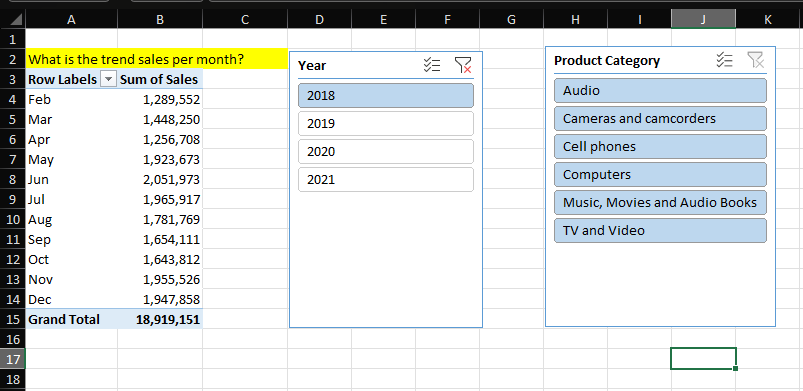

 📊 Sales Performance Analysis Project
 
## 🎯 Project Overview

An interactive **Excel-based Sales Analytics Dashboard** designed to analyze multi-year sales data across different manufacturers, products, channels, and regions. This project demonstrates advanced data analysis techniques including PivotTables, Slicers, and dynamic dashboards to uncover actionable business insights.

---

## 📈 Key Performance Indicators (KPIs)

| Metric | Value |
|--------|-------|
| **Total Sales** | $17,284,123.59 |
| **Total Profit** | $11,237,878.22 |
| **Profit Margin** | ~65% |
| **Manufacturers Tracked** | 10 |
| **Product Categories** | 6 |
| **Sales Channels** | 4 |
| **Regions Covered** | 3 (Asia, Europe, North America) |

---

## 🏆 Key Findings & Insights

### 💰 Most Profitable Manufacturers

| Manufacturer | Profit | Sales |
|--------------|--------|-------|
| Adventure Works | $186,380 | $286,276 |
| Fabrikam, Inc. | $180,990 | $284,378 |
| Contoso, Ltd | $135,268 | $225,378 |
| Wide World Importers | $123,236 | $182,103 |
| Proseware, Inc. | $77,777 | $126,782 |

### 📦 Product Category Performance
- **Computers** dominate with **$4.79M** in profits (42.7% of total)
- **Cameras and camcorders** follow at **$3.08M** (27.4%)
- **TV and Video** at **$1.75M** (15.6%)

### 🌍 Regional Analysis
- **North America** leads with **$6.23M** profit (55.5%)
- **Asia** follows with **$3.24M** (28.9%)
- **Europe** at **$1.76M** (15.7%)

### 🏪 Channel Performance
- **Store** is the most profitable channel at **$6.29M** (56%)
- **Online** channels generate **$2.33M**
- **Reseller** at **$1.61M**
- **Catalog** at **$1.00M**

### 📅 Monthly Sales Trend

---

## 🛠️ Tools & Techniques Used

- **Microsoft Excel**
  - PivotTables for data aggregation
  - PivotCharts for visualizations
  - Slicers for interactive filtering
  - VLOOKUP & TEXT functions for data transformation
  - Conditional Formatting for data highlights
  - Dashboard design with linked charts
    
---

## 💡 Business Recommendations

1. **Focus on North America** - Generates 55% of profits; maintain strong presence
2. **Expand Asia operations** - Fast-growing region with 29% share
3. **Optimize Online Channel** - Growth potential despite lower profit share
4. **Review low-margin products** - Some MP3 players and phones show negative profits
5. **Leverage January spike** - Capitalize on post-holiday/New Year sales momentum

---

#Dashboard Visuals 

