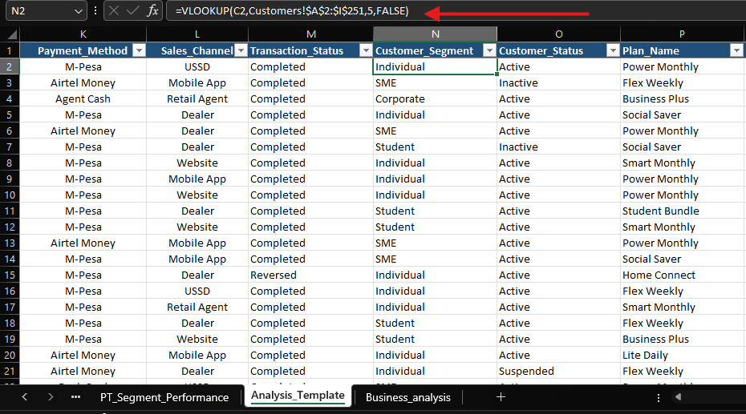
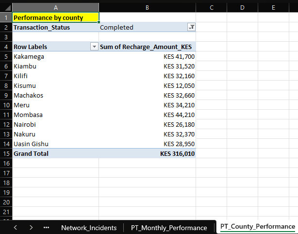
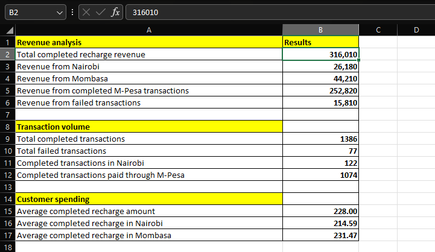

# TelConnect Kenya – Telecommunications Business Performance Analysis

## 1. Project Overview

This project involves analysing simulated business data for a fictional telecommunications company, **TelConnect Kenya Ltd.**, using Microsoft Excel.

The objective was to transform raw telecommunications transaction data into meaningful business information by applying Excel formulas, data analysis techniques and PivotTables.

The analysis focuses on understanding recharge transaction performance across different counties, subscription plans, customer segments and payment methods, while identifying patterns that could support business decision-making.

**Tools Used:** Microsoft Excel  
**Industry:** Telecommunications  
**Analysis Period:** January – December 2025  
**Currency:** Kenyan Shillings (KES)

---

## 2. Business Objectives

The project aimed to answer key business questions, including:

- What is the total value of completed recharge transactions?
- How does recharge performance vary across different months?
- Which counties contribute the highest recharge value?
- Which subscription plans generate the most recharge value?
- Which payment methods are most commonly used?
- Which customer segments contribute the most to completed recharge value?
- What proportion of transactions are completed, failed or reversed?
- What insights can be drawn from the transaction data to support business decisions?

---

## 3. Dataset Description

The project uses a synthetic telecommunications dataset containing several interconnected worksheets:

| Dataset | Description |
|---|---|
| Customers | Customer information and classifications |
| Usage Data | Recharge transactions and usage records |
| Plans | Subscription plan details |
| Regions | Regional and county information |
| Support Tickets | Customer support records |
| Network Incidents | Network incident records |

The dataset includes approximately:

- 250 customers
- 1,500 recharge transactions
- 400 support tickets
- 120 network incidents
- 8 subscription plans
- 10 regions/counties

## 4. Excel Skills and Techniques Applied

The following Excel techniques were applied throughout the project:

VLOOKUP, IF, Nested IF, IFERROR, SUMIFS, COUNTIFS, AVERAGEIFS, PivotTables

An example of a vlookup used during the project:

## 5. Business Performance Analysis

PivotTables were developed to examine business performance across several dimensions:
**Monthly Performance**

**County Performance**

**Subscription Plan Performance**

**Payment Method Analysis**

## 6. Business analysis
Formula used: SUMIF, COUNTIF and AVERAGE IF 

## 6. Key Findings and Business Recommendations

The analysis was intended to identify performance patterns and generate practical business insights.

Key findings and recommendations are based on the actual results obtained from the Excel analysis.

## 📊 Key Findings

* **Overall Revenue & Transaction Health:** The platform generated **KES 316,010** in completed recharge revenue across **1,386** successful transactions, with an average transaction value of **KES 228.00**. However, **77 failed transactions** resulted in **KES 15,810** in lost revenue (a ~5.3% transaction failure rate).
* **Payment Method Dominance:** **M-Pesa** is the primary payment driver, accounting for nearly **79%** of all completed transactions (**1,074**) and generating **KES 252,820** (80%) of completed revenue. Airtel Money is a distant second at KES 38,000 (across all statuses).
* **Regional Performance:** **Mombasa** (KES 44,210) and **Kakamega** (KES 41,700) are the top-performing counties by completed revenue. In contrast, **Kisumu** recorded the lowest revenue at **KES 12,050**, while **Nairobi** underperformed relative to its market size at **KES 26,180** (averaging KES 214.59 per recharge compared to Mombasa's KES 231.47).
* **Subscription Plan Distribution:** Revenue across the eight subscription plans (including all transaction statuses) is fairly balanced at a total of **KES 341,110**, led by **Home Connect** (KES 45,280), **Flex Weekly** (KES 44,970), and **Lite Daily** (KES 44,870), while **Power Monthly** recorded the lowest share at KES 35,460.
* **Seasonality Trends:** Completed monthly revenue peaked in **August** (KES 35,030) and **December** (KES 34,550), while experiencing notable dips in **May** (KES 21,550) and **July** (KES 21,650).

---

## 💡 Recommendations

* **Optimize Payment Reliability:** Prioritize M-Pesa gateway stability and investigate the root causes behind the **77 failed transactions** (such as network timeouts or payment processing errors) to recover the **KES 15,810** in lost revenue.
* **Target Underperforming High-Potential Regions:** Launch localized marketing campaigns and user acquisition initiatives in **Nairobi** and **Kisumu** to bring their transaction volumes and average recharge values closer to top-performing counties like Mombasa.
* **Boost Underperforming Plans:** Review the pricing, data allocation, or marketing visibility of **Power Monthly** (KES 35,460) and **Business Plus** (KES 40,610) to increase adoption alongside top-performing plans like Home Connect and Flex Weekly.
* **Leverage Seasonal Peaks & Address Dips:** Introduce targeted promotions, bundle discounts, or loyalty rewards during slower months (**May, July, and November**) to stabilize cash flow, while scaling infrastructure and marketing ahead of peak demand in **August and December**.

