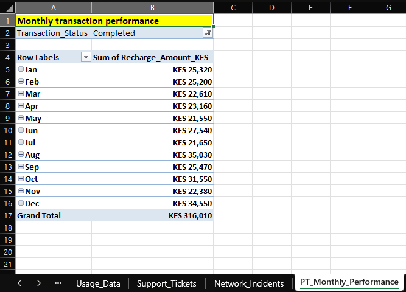
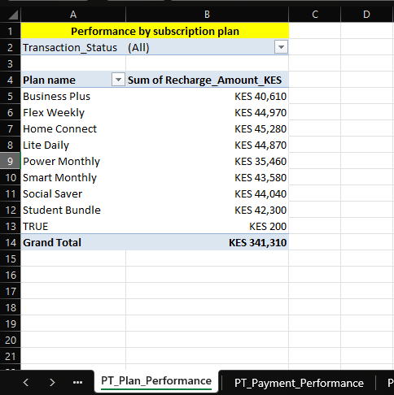
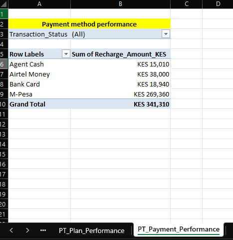

# TelConnect Kenya – Telecommunications Business Performance Analysis

## 1. Project Overview

This project involves analysing simulated business data for a fictional telecommunications company, **TelConnect Kenya Ltd.**, using Microsoft Excel.

The objective was to transform raw telecommunications transaction data into meaningful business information by applying Excel formulas, data analysis techniques and PivotTables.

The analysis focuses on understanding recharge transaction performance across different counties, subscription plans, customer segments and payment methods, while identifying patterns that could support business decision-making.

**Tools Used:** Microsoft Excel  
**Industry:** Telecommunications  
**Analysis Period:** January – December 2025  
**Currency:** Kenyan Shillings (KES)

---

## 2. Business Objectives

The project aimed to answer key business questions, including:

- What is the total value of completed recharge transactions?
- How does recharge performance vary across different months?
- Which counties contribute the highest recharge value?
- Which subscription plans generate the most recharge value?
- Which payment methods are most commonly used?
- Which customer segments contribute the most to completed recharge value?
- What proportion of transactions are completed, failed or reversed?
- What insights can be drawn from the transaction data to support business decisions?

---

## 3. Dataset Description

The project uses a synthetic telecommunications dataset containing several interconnected worksheets:

| Dataset | Description |
|---|---|
| Customers | Customer information and classifications |
| Usage Data | Recharge transactions and usage records |
| Plans | Subscription plan details |
| Regions | Regional and county information |
| Support Tickets | Customer support records |
| Network Incidents | Network incident records |

The dataset includes approximately:

- 250 customers
- 1,500 recharge transactions
- 400 support tickets
- 120 network incidents
- 8 subscription plans
- 10 regions/counties

## 4. Excel Skills and Techniques Applied

The following Excel techniques were applied throughout the project:

VLOOKUP, IF, Nested IF, IFERROR, SUMIFS, COUNTIFS, AVERAGEIFS, PivotTables

## 5. Business Performance Analysis

PivotTables were developed to examine business performance across several dimensions:
**Monthly Performance**

**County Performance**

**Subscription Plan Performance**

**Payment Method Analysis**

## 6. Business analysis

## 6. Key Findings and Business Recommendations

The analysis was intended to identify performance patterns and generate practical business insights.

Key findings and recommendations are based on the actual results obtained from the Excel analysis.

**Key Findings**
- [Insert your finding on monthly performance.]
- [Insert your finding on county performance.]
- [Insert your finding on subscription plans.]
- [Insert your finding on payment methods.]
- [Insert your finding on customer segments.]
- [Insert your finding on transaction outcomes.]

**Business Recommendations**
- [Insert a recommendation supported by your findings.]
- [Insert a recommendation supported by your findings.]
- [Insert a recommendation supported by your findings.]

